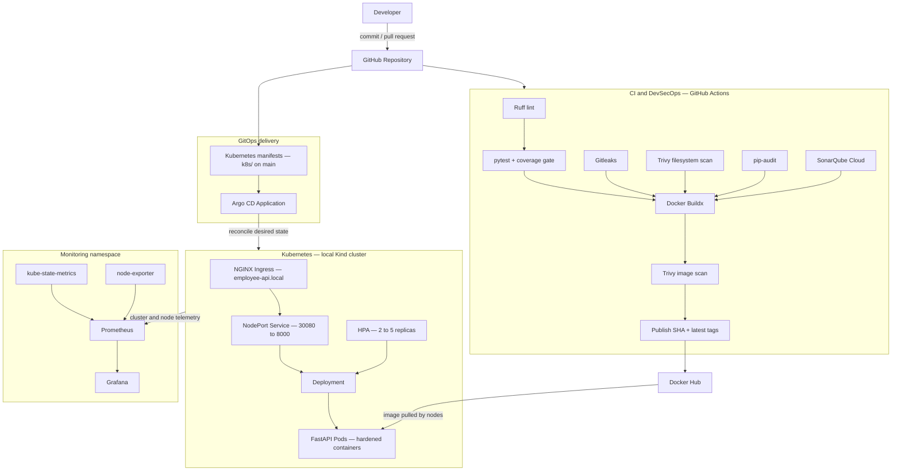

# Platform Architecture

## 1. Logical architecture



## 2. Delivery sequence

1. A developer opens a pull request or pushes a change to main.
2. GitHub Actions runs linting, automated tests, coverage enforcement, secret detection, filesystem scanning, dependency auditing, and SonarQube Cloud analysis.
3. After required checks pass on a push to main, the Docker image is built and scanned.
4. The image is published to Docker Hub with the source commit SHA and latest tag.
5. For a release, the Deployment manifest's image reference is promoted to the selected immutable SHA tag and committed to main.
6. Argo CD detects the desired-state change and reconciles the Kubernetes resources.
7. Kubernetes routes traffic through NGINX Ingress and the Service to FastAPI pods. The HPA can scale replicas based on CPU utilization.
8. Prometheus collects Kubernetes state and node telemetry; Grafana is used to explore dashboards.

## 3. Runtime request path

```text
Client
  |
  v
NGINX Ingress (employee-api.local)
  |
  v
Kubernetes Service (employee-api:8000)
  |
  v
Deployment (HPA-controlled replicas)
  |
  v
FastAPI container (port 8000)
  |-- GET /
  |-- GET /health
  |-- GET /version
  `-- GET /docs
```

## 4. Security controls

| Layer | Control |
|---|---|
| Source | Gitleaks secret detection |
| Dependencies | Hash-pinned lock file and pip-audit |
| Code | Ruff, tests, coverage gate, SonarQube Cloud |
| Filesystem | Trivy vulnerability and misconfiguration scan |
| Container | Multi-stage build, non-root UID 10001, read-only application file |
| Image | Trivy scan before Docker Hub publication |
| Kubernetes pod | runAsNonRoot, UID/GID 10001, RuntimeDefault seccomp |
| Kubernetes container | Read-only root filesystem, no privilege escalation, all capabilities dropped |
| Runtime | Readiness/liveness probes and CPU/memory requests/limits |
| Secrets | GitHub Actions secrets and Kubernetes Secret references; never commit values |

## 5. Monitoring scope

The current lab deploys Prometheus, Grafana, kube-state-metrics, and node-exporter. It provides Kubernetes object and node-level visibility. The FastAPI code does not yet expose a Prometheus metrics endpoint, so service-level request latency and error-rate dashboards are future enhancements.

Prometheus retention is configured for three days and persistent volumes are disabled in the current lab setup. This is suitable for repeatable learning exercises, not durable production monitoring.

## 6. Current deployment boundaries

- Kubernetes runs in a local Kind cluster rather than a managed production cluster.
- The image is published to Docker Hub; release promotion is represented by changing the immutable image SHA in the Kubernetes Deployment manifest.
- Argo CD tracks the main branch and the k8s path.
- AWS, Terraform, database persistence, application metrics instrumentation, and production secret management are not part of the implemented scope.
